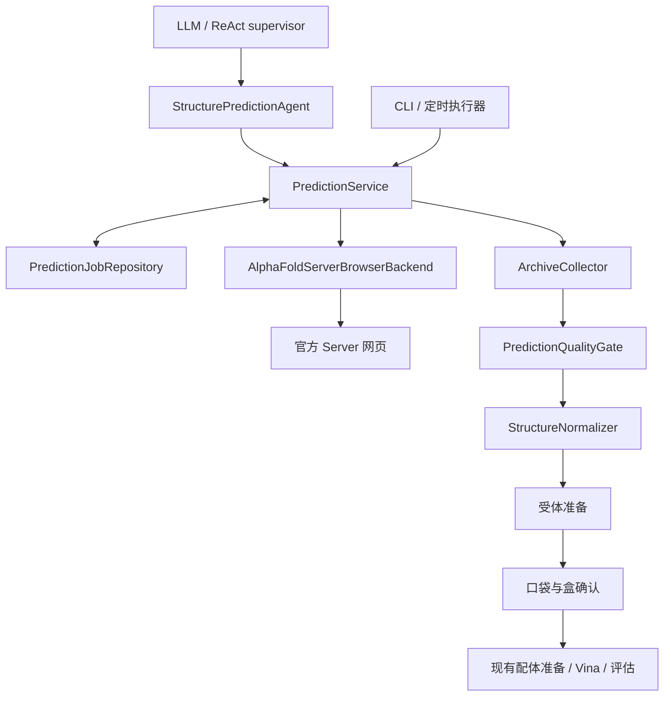

# AlphaFold Server 自动预测分支设计

状态：设计完成，待实现。日期：2026-10-29（Asia/Shanghai）。

本文定义官方 AlphaFold Server 的请求、网页提交、异步等待、完整下载、质量检查，以及返回现有 docking workflow 的接口。文中的新增类、状态和命令均为拟议接口，尚未实现。本轮未打开登录浏览器、提交任务或启动后台监控。

## 1. 目标和第一版范围

用户完成必要登录，并授权指定请求后，系统自动提交一次预测任务；本地进程可以退出，之后继续跟踪同一个远程任务。结果下载并通过检查后，提供带来源和编号映射的预测结构，供 PDBFixer/Meeko 和 Vina 使用。

第一版支持一个目标、单条标准蛋白序列、单拷贝、一个 Server job。保留该任务返回的全部 seed/sample；选择一个结构进入现有单受体对接流程。请求可以包含经当前官方文档验证的固定种子；不固定假设返回模型数量。多链复合物、核酸、自定义修饰和辅因子留给后续扩展，不能静默丢弃请求中的实体。

小分子由现有 RDKit/xTB/Meeko/Vina 流程处理；不向 Server 提交自定义 SMILES，也不将蛋白单体预测描述为蛋白–配体复合物预测。需要寡聚体才能形成的口袋不属于第一版自动放行范围。

默认来源顺序：RCSB PDB → AlphaFold DB → AlphaFold Server。仅在明确无匹配且策略允许时进入下一来源。网络错误、登录失败、下载损坏均不等同于无匹配。已有结构是否适合目标是单独的科学判断；第一版不借这次改造宣称已实现自动结构适用性选择。

端到端验收可显式指定 `alphafold_server` 后端，以公开序列验证本分支；这记录为用户指定的预测，不伪造 PDB/AlphaFold DB 无匹配。来源自动回退的路由另做集成验收。

## 2. 当前代码与缺口

| 位置 | 现有行为 | 需要调整 |
|---|---|---|
| `integrations/structure.py` | `AlphaFoldServerRequestProvider` 只生成 JSON，返回 `waiting_approval` | 保留请求构建能力，新增异步 Server 后端；查询已有任务优先于重新生成请求 |
| `ports.py` | `StructureProvider.predict()` 一次返回结构或等待 | 增加远程预测端口，现有接口通过适配器复用 |
| `contracts.py` | 没有远程任务记录或 `waiting_remote` | 增加可序列化的请求、任务引用、等待原因和版本字段 |
| `agents/modules.py` | StructureAgent 只特别处理预测审批，其余非成功易归为失败 | 正确传播等待和远程任务状态；未产生合格结构时禁止完成结构阶段 |
| `agents/react.py` | 没有检查/继续预测工具；完成判断主要基于阶段和 artifact | 新增短时预测工具、停止等待规则和预测来源/QC 前置条件 |
| `runtime.py` | `waiting_input` 要求新建运行，审批仅恢复受体/盒；同步构建 Vina 引擎 | 按等待原因恢复同一运行；延迟构建依赖盒坐标的引擎 |
| `cli.py` | `run` 在结构获取前就要求 center/size，控制器要求至少一个配体 | 增加独立预测命令；完整 workflow 可先获取结构，盒缺失时到对接阶段再等待 |
| `storage.py` | artifact 不可覆盖，manifest 原子替换，但跨文件无事务 | 增加远程任务版本日志，明确事实来源和崩溃恢复顺序 |

现有 skill 工具可复用：`build_server_json.py`、`validate_server_json.py`、`alphafold_server_browser.sh`、`inspect_server_zip.py`。ZIP 工具目前会在缺少模型/置信度文件时只给警告，并未覆盖所有解压风险；其退出码为零不能直接作为本模块成功条件。

## 3. 模块职责和调用路径



- `StructurePredictionAgent`：向 LLM 提供请求摘要、任务状态和 QC 证据；执行受约束的高层操作。
- `PredictionService`：确定性的状态迁移、授权核验、提交去重、恢复和产物发布。CLI 和 Agent 共用此服务。
- `PredictionJobRepository`：任务事实记录、版本校验、原子提交和并发锁，不依赖 LangGraph 内存。
- `AlphaFoldServerBrowserBackend`：网页交互、可见任务信息读取和浏览器下载。页面定位逻辑集中管理；不抓取登录凭据或调用逆向得到的私有接口。
- `ArchiveCollector`：原始 ZIP 校验、受控解压、结构/置信度配对和来源核对。
- `PredictionQualityGate`：序列与链核对、局部置信度、结构几何及候选模型决策。
- `StructureNormalizer`：mmCIF 读取、可表示性检查、PDB 派生文件及编号映射。

LLM 不持有密码、cookie 或签名下载链接，不负责循环点击刷新、长时间等待、计算置信度或决定重复提交。它只能根据工具实际返回选择允许的后续动作。后台执行器不需要调用 LLM；恢复完整工作流时再启动一次新的 ReAct 会话。

拟议文件：`prediction/contracts.py`、`prediction/service.py`、`prediction/repository.py`、`integrations/alphafold_server_browser.py`、`integrations/alphafold_archive.py`、`integrations/prediction_qc.py`、`integrations/structure_normalization.py`。

## 4. 数据契约

### PredictionRequest（冻结）

字段：`schema_version`、`provider`、`target_id`、`sequence_source`（accession/version、organism、isoform、原始 FASTA artifact）、`normalized_sequence_sha256`、`entities`（顺序与 copy 数）、`seeds`、`server_options`、`job_name`、`request_artifact_id`、`exact_json_sha256`、`request_fingerprint`。

允许规范化空白与大小写；不得改变生物序列、截短、换 isoform 或补未知残基。无法解析来源的输入标为用户提供，来源/上传权限不明确时等待输入。

`request_fingerprint` 为规范化科学内容与服务选项的 SHA256，不包含易变的提交时间和显示名称；它标识“相同请求”，不是远程服务幂等键。`exact_json_sha256` 校验实际上传文件。每次有意重算使用新的本地 `attempt_id`，即使 fingerprint 相同也记录为不同 attempt。

唯一显示名称在准备 attempt 时生成并写入冻结请求。再次有意提交时生成新名称和新的请求文件引用，科学 fingerprint 可以相同，实际 JSON 哈希会变化；提交授权必须覆盖这次 attempt，不能复用已消费的一次性授权。

### PredictionJob（按 revision 持久化）

字段：`local_job_id`、`attempt_id`、`request_fingerprint`、`request_artifact_id`、`revision`、`phase`、`blocker`、`resume_phase`、`remote_job_id`、`public_job_locator`、`submission_receipt_artifact_id`、`created_at`、`submitted_at`、`last_checked_at`、`next_poll_at`、`retry_count`、`last_error`、`download_artifact_ids`、`qc_artifact_id`、`selected_structure_artifact_id`。

时间持久化为带时区的 UTC，展示使用 Asia/Shanghai。任务定位字段只包含不带认证信息的可见 ID/页面位置；不保存签名下载 URL、cookie、token 或浏览器存储。

`blocker` 单独表示 `authentication`、`terms`、`submission_authorization`、`quota`、`submission_unknown`、`network`、`site_changed`、`quality_review`、`missing_site` 等；阻塞不清除远程 ID 或之前的阶段。

### 远程预测端口（拟议签名）

```python
prepare(target, policy, context) -> PredictionRequest
submit(request_id, authorization_ref, context) -> PredictionObservation
reconcile(local_job_id, context) -> PredictionObservation
poll(local_job_id, context) -> PredictionObservation
collect(local_job_id, context) -> PredictionObservation
assess(local_job_id, site_spec, qc_policy, context) -> PredictionObservation
```

每次调用只执行有上限的一次状态推进，不在工具内部等待整个排队周期。`PredictionObservation` 包含 `phase`、`blocker`、本地/远程 ID、artifact 引用、`next_poll_at`、`allowed_actions`、结构化错误及可重试性；不得把错误分数填成 0。

### 对现有 workflow 的返回

`RunStatus` 新增 `WAITING_REMOTE`；人类介入复用 `WAITING_INPUT` / `WAITING_APPROVAL`，用 `stage_results` 内的等待原因区分。`RunState` 新增 `schema_version` 和 `prediction_jobs` 引用，旧 manifest 的缺省值为 v1/空列表；旧客户端不能被声称兼容新增状态。

`ToolResult.status` 增加 `waiting_remote`。仅当请求对应的结构、QC、编号映射齐全且可用时，返回 `predicted_structure` 并将 `structure` 阶段设为 `succeeded`。ZIP 存在或 Server 显示完成都不能完成结构阶段。

## 5. 状态与恢复

| 任务阶段 phase | 进入条件 / 动作 | 下一步 |
|---|---|---|
| `prepared` | 请求构建和校验成功 | 授权、登录及当前页面能力检查后提交 |
| `submitting` | 本地提交意图已持久化，准备执行唯一一次点击 | 得到回执进入 `queued`/`running`；不确定则 reconcile |
| `queued` / `running` | 已核实远程任务，或收到其状态变化 | 到期 poll；本地进程可以退出 |
| `remote_complete` | 同一任务的网页显示成功 | 获取完整 ZIP |
| `downloading` | 下载尝试已记录 | 下载完成并核验后进入 `downloaded` |
| `downloaded` | ZIP 有效且结果与请求对应 | QC、选模和结构规范化 |
| `ready` | 合格结构、QC 和映射均已发布 | 向结构阶段提供 artifact |
| `failed` | 明确的服务失败或不可恢复内容错误 | 保留诊断；新 attempt 需独立操作 |

任何阶段可附带 blocker。认证失效恢复后继续原 phase。取消本地 watcher 只停止查询，不表示取消远程任务；第一版不实现远程取消。

### 防重复提交

1. 获取运行锁和浏览器会话锁，读取最新 job revision；核验请求摘要与授权一致。
2. 检查现有本地记录及网页任务，不把重复的 Agent 调用当作新请求。
3. 记录提交意图、请求哈希、唯一 job name、时间和页面核对摘要，并确保落盘；之后才能点击最终提交。
4. 取得可见任务 ID/稳定任务定位信息后写入回执，再更新 job。若网页没有可核实的唯一定位依据，进入待确认状态，不宣称“已提交”。
5. 提交超时、浏览器崩溃或进程在步骤 3–4 间退出，恢复后只允许 `reconcile`。按可见任务 ID、唯一名称、时间和可见序列摘要核对，匹配不唯一则等待人工指定。
6. 查不到不等于未提交，不自动再次点击。经确认确实无任务后，显式创建新 attempt。不能承诺网页服务上的 exactly-once 提交。

### 持久化与并发

远程任务 revision 日志是任务事实来源，manifest 是可重建的投影。每个 revision 文件包含完整 job 状态、事件、前一版本哈希和新 artifact 引用，写入临时文件、fsync 后原子改名，再更新 manifest。目录 fsync 也纳入提交步骤；依赖现有存储代码时需补齐。

所有进程先获取同一 `.run.lock`；需要浏览器时再获取会话级锁，锁顺序固定。观察完成即释放，绝不在轮询间隔持锁。不同 run 共享同一浏览器也需串行。只支持同机单写者/文件锁可靠的存储环境，首版不宣称跨主机分布式锁能力。

崩溃后：读取最后一个连续且哈希有效的 revision，将 manifest 补到该版本。若只有持久化提交意图，按“不确定提交”恢复；若有有效 ZIP/结构产物但尚未挂入 manifest，通过哈希和任务映射重建引用，不能覆盖历史 artifact。远程阶段的陈旧 `running` 通过上述规则恢复；不得顺带取消现有本地计算的“中断后新建运行”保护。

## 6. 浏览器、授权与运行环境

复用专用可见 `alphafold-server` 会话。首次登录、MFA、验证码和新条款接受由用户在浏览器完成。浏览器 profile 可在本机保留登录，但不读取、导出或复制其凭据；项目结果目录和归档排除 profile。使用身份不明确时让用户在界面确认，不遍历账户下无关任务。

开始实际提交前检查网络、可见桌面、浏览器包装脚本和会话目录可写性。部署时使用专用且获准的浏览器会话，不能通过复制 cookies 绕过登录流程。Headless 仅用于未登录连通性诊断。

按照页面快照定位控件，导航或重要 UI 变化后重新取快照。只保留任务相关、已脱敏的页面证据；登录页、验证码页不采集凭据截图或 DOM。官方文档/服务能力和条款每次提交前核对并记录检查时间；不把 skill 的旧名单或额度当作当前事实。

提交授权绑定指定 request 哈希、服务、上传范围和 attempt/允许次数。已明确授权的同一请求无需重复询问；修改序列、实体或种子会产生新请求。预测许可 `allow_structure_prediction=True` 本身不代表允许向外部服务上传任意序列。LLM 无权生成授权；CLI、应用按钮或当前会话的明确用户授权可以生成记录。

本轮“开始设计”不构成实际提交某条序列的授权。实现中遇到登录等阻塞时，展示具体原因和恢复动作。登录和提交由用户明确控制，远端任务回执保存在运行目录。

## 7. 轮询与故障策略

默认建议：首次间隔 60 秒，之后 120、240、最高 600 秒，加约 ±10% 抖动；以当前服务限制为优先。持久化 `next_poll_at`，到期前再次调用不会访问网页。一次页面操作建议上限 60 秒；进入新的页面操作前重新检查 blocker。

临时网络故障采用有限次数退避，例如连续 5 次后保留远程任务并进入 `waiting_input(network)`，不标为远程失败，也不转回提交。额度耗尽记录页面可见重置信息并等待；不自动换账户。未知页面/状态进入 `site_changed`，不能猜测成功。

`poll --once` 用于手动或调度器调用；`watch` 是可中断的前台执行器。没有 watcher 或外部调度器时，已退出的进程不会自动继续。本设计不自动安装定时任务。未来可让现有应用/部署调度器周期调用 tick；仅在完成、失败或需要用户介入时通知，状态无变化时保持安静。

后台 tick 只管理远程任务和本地产物。默认下载/QC 完成后等待 `run` 继续；用户事先配置 `continue_on_ready` 时，执行器可在释放浏览器锁、持有运行锁并检查输入版本后启动新的 LLM 控制器继续流程。继续失败不撤销已取得的预测结果。

## 8. 下载和结构质量

每次下载使用独立 attempt 目录，等待浏览器下载完成事件；不把临时文件视为完整 ZIP。下载完整结果包，保留原文件和 SHA256。失败重试写新文件，完整性验证成功后才发布 artifact。下载必须由已确认的任务页面触发；归档中有请求时按实体/序列/种子语义核对，服务补全字段与本地原始请求分别保留。

受控解压除 CRC 外，还需拒绝绝对路径、路径穿越、软链接、重复/规范化后冲突的成员路径，并设置成员数、单文件及总展开大小上限。限制应在读取/展开前检查，实际读取时再限制字节数。下载到的 HTML 错误页、只有模型没有置信度、模型与置信度维度不符、未知布局不能成功；进入失败或待审查并保留证据。条款/排名文件若服务不提供则明确记录，不伪造文件或排名。

QC 顺序：

1. 序列、实体数量、链顺序和编号对应；核对 atom/token 映射，不把 token PAE 简单当作每残基矩阵。
2. 全部模型坐标可解析且有限，记录缺失、严重碰撞、服务报告的失败标记和置信度缺失。
3. 计算指定口袋区域的逐残基 pLDDT 分布，以及涉及口袋的域间 PAE；报告数据来源、归约方法和缺失值，不以全局均值替代。
4. 使用版本化 QC policy。首版默认需审查预测结构；只有用户选择了明确且适用于该靶点的阈值策略、口袋定义和序列映射完整、全部必要检查通过，才允许自动放行。本文不把某个 pLDDT/PAE 阈值定义为普适对接适用标准。
5. 保留所有模型；按服务提供且已验证含义的 ranking，在通过同一 QC policy 的候选中选最高者。无可用排名或候选差异影响口袋时等待审查。拒绝候选及原因保留，不按事后对接分数反选“最佳预测”。

原始 mmCIF 始终保留。派生 PDB 必须检查链 ID、残基/原子编号及坐标字段能否无损表示，生成 `residue_map.json`（输入序列位置 ↔ mmCIF label/auth 编号 ↔ 派生 PDB 编号）。若存在不支持表示或歧义，停止转换；不静默截断链名、丢链或重编号而不记录。

预测结构 metadata 必须包含 `source=alphafold_server`、`predicted=true`、`chemically_prepared=false`、请求/任务/样本/seed、原始 mmCIF artifact、QC policy/结果和映射 artifact。置信度不等于结合亲和力。

## 9. 与受体准备和对接盒的衔接

新增 `BindingSiteSpec`：输入序列位置集合及序列哈希，或显式结构坐标定义及其结构哈希。现有 `A:57` 只对指定结构编号有意义，不能自动解释为新预测结构中的同名残基。

预测模型确定后，经映射得到口袋残基；未知口袋进入 `waiting_input(missing_site)`。第一版不集成新的口袋预测算法。受体准备保留映射，若坐标发生变换则记录变换并更新引用。

`DockingBoxSpec` 包含中心、全边长（Å）、生成方法、依据残基/参考配体和最终受体坐标哈希。根据新结构计算盒并核对，再按现有政策确认；旧受体的盒和批准不能复用。若受体版本改变，重新计算指纹并使原批准失效。

因此 `run` 应允许暂不提供盒，在对接前等待补充；不得用全零中心或占位盒提前构建 Vina。已有显式 center/size 的 PDB 运行继续按原路径执行，但记录坐标归属。只做结构预测的子命令不需要配体、xTB 或 Vina。

## 10. 拟议 Agent 工具和 CLI

Agent 工具：`prepare_prediction`、`submit_prediction`、`inspect_prediction`、`advance_prediction`。参数引用本地 request/job ID，不接受任意网页 URL或可执行脚本。`advance_prediction` 根据阶段执行到期 poll、collect 或 assess；不能借此创建新提交。得到等待状态后模型解释原因并结束本轮，不自行 sleep 或重复调用。

以下为未来命令形式，当前不可执行：

```text
dock-agent prediction prepare --run-root RUN --provider alphafold-server
dock-agent prediction submit --run-root RUN --request-id ID --authorization-id AUTH
dock-agent prediction reconcile --run-root RUN --job-id ID
dock-agent prediction poll --run-root RUN --job-id ID --once
dock-agent prediction watch --run-root RUN --job-id ID
dock-agent prediction collect --run-root RUN --job-id ID
dock-agent prediction review --run-root RUN --job-id ID --model-id MODEL --qc-report-sha256 HASH
dock-agent run --run-root RUN [本次结构对应的盒和批准]
```

独立预测使用 `prediction init --run-root RUN --target-id ID --fasta PATH --accession ACCESSION` 建立目标运行，可无配体。若后来扩展为 docking 运行，新增的配体/盒配置按版本记录，不能覆盖提交用的目标输入。`review` 只确认指定模型和指定 QC 报告；硬错误（序列不符、损坏归档、坐标不合法）不能批准绕过。

`status` 保持本地只读，展示任务阶段、最后检查时间、下次查询时间、阻塞原因和恢复命令，不暗示当前显示的是刚刚从服务读取的状态。退出码沿用 0 成功、1 失败、2 未完成/等待，并同时输出机器可读的具体状态。

## 11. 目录布局

```text
<run>/
  inputs/prediction/<request-id>/
    source.fasta  source.json  request.json  policy.json
  work/prediction/<job-id>/
    browser/                 # 已脱敏任务证据；不含浏览器 profile
    downloads/<attempt-id>/  # 下载临时文件
    extraction/<attempt-id>/
  results/prediction/<job-id>/
    submission-receipt.json
    archives/<attempt-id>/result.zip
    samples/<sample-id>/    # 原始 mmCIF、confidence、ranking 等
    qc/<policy-hash>/report.json
    selected/<selection-id>/structure.pdb  residue_map.json
  state/prediction/<job-id>/revisions/000001.json
  logs/prediction/<job-id>/
  manifest.json
```

所有外部程序使用明确工作目录和绝对输入/输出路径。对原始 ZIP、请求、QC、选模使用不可覆盖的 artifact；策略变更生成新版本而不替换已发表结果。浏览器登录 profile 留在独立受保护的本机位置，退出 watcher 不删除已有任务产物。

## 12. 实现顺序和验收

| 阶段 | 实现内容 | 必须满足的验收 |
|---|---|---|
| A：状态与恢复 | 契约、job repository、等待状态、迁移和锁 | 无浏览器的状态迁移/崩溃注入检查；新客户端能读旧 manifest；同一请求重复调用不产生新 attempt |
| B：网页后端 | 登录交接、请求导入、摘要核对、提交回执、状态识别 | 页面变化/登录失效不误报成功；模拟提交后丢回执只 reconcile；同一 profile 并发操作串行 |
| C：归档与科学接口 | 完整 ZIP、关联校验、QC、mmCIF/PDB 和编号映射 | 损坏包、缺置信度、错序列、危险路径/链接/超大包被拒绝；低质量/未知口袋进入等待 |
| D：工作流整合 | Agent 工具、CLI、源选择、盒延迟配置、准备衔接 | `waiting_remote` 不被记为失败；新会话从 job 恢复；旧盒不能进入预测受体对接 |
| E：真实验收 | 用户授权一个公开单蛋白任务 | 提交一次，关闭本地执行器，重新启动找回同一远程任务，完整下载，核验/QC，生成受体输入 |
| F：下游回归 | 已知口袋的预测受体＋一个配体 | 真实 LLM 读取恢复后的状态并完成 PDBFixer/Meeko/Vina/评估；另验证既有 181L 路径不受影响 |

A–D 的自动化验证只在用户授权实现/验证后执行。真实 E–F 需要届时的服务可达性、账户登录、额度和具体请求授权；本地模拟全部通过不能替代真实远程验收。首次 E 可与断点恢复结合，只消耗一个提交任务；任务耗时/额度以服务实际显示为准。

设计完成标准：职责、数据、状态、恢复、授权、产物、结构/盒映射、代码改动和验收均已定义。实现完成标准：E 成功并有真实回执与完整产物；整条预测 docking 分支打通还要求 F 成功。不得把本设计文档标记为功能已实现。

## 13. 参考与提交前检查

- [官方服务](https://alphafoldserver.com/)
- [官方 Server 输入文档](https://github.com/google-deepmind/alphafold/tree/main/server)
- [本地 AF3 输入格式，用于区分 Server dialect](https://github.com/google-deepmind/alphafold3/blob/main/docs/input.md)
- [AlphaFold Server skill](../../.agents/skills/alphafold-server/SKILL.md)

本地参考文档曾于 2026-08-06 核对官方支持范围；本次设计没有检查登录后的当前页面。因此 UI 选择器、额度、最新可接受选项和实际归档布局需在实现/提交时重新确认，页面内容以届时实际服务为准。
